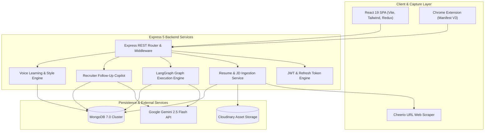
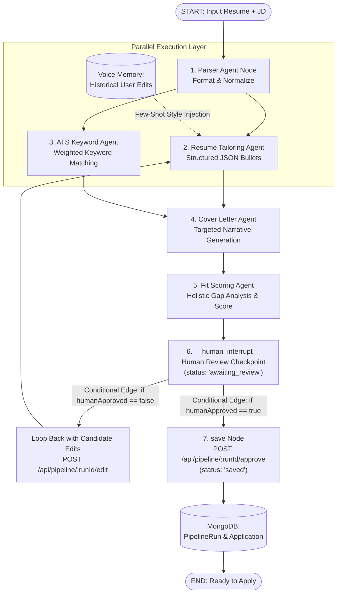
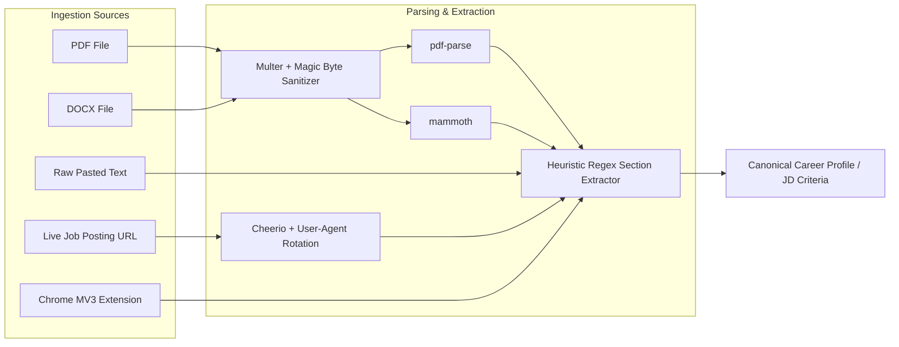

# ApplyForge Architecture Specification

[← Back to Documentation Hub](README.md) • [API Reference](API.md) • [Database Design](DATABASE.md) • [Setup Guide](SETUP.md)

---

## 1. System Overview

**ApplyForge** is an agentic job application copilot engineered to automate and elevate the job application workflow. Unlike traditional static AI resume tools that merely rewrite text, ApplyForge employs a multi-agent directed acyclic graph (DAG) built on **LangChain** and **LangGraph**, combined with **Google Gemini 2.5 Flash**. The architecture enforces a deterministic **Human-in-the-Loop (HITL)** checkpoint, preventing hallucinations and giving the candidate complete editorial veto power before persisting any assets to their personal CRM.



---

## 2. Multi-Agent Pipeline Topology (LangGraph)

The core intelligent tailoring engine is orchestrated as a stateful computational graph using `@langchain/langgraph`.



### 2.1 Agent State Schema

The shared state passed through the graph channels is defined with TypeScript-compatible validation:

```javascript
{
  // Primary Identifiers
  resumeId: string,
  jdId: string,
  userId: string,
  runId: string,

  // Ingested Source Documents
  rawResumeText: string,
  rawJDText: string,
  parsedResume: {
    contact: Object,
    summary: string,
    experience: Array<WorkExperience>,
    education: Array<EducationItem>,
    skills: Array<string>,
    certifications: Array<CertificationItem>
  },
  parsedJD: {
    company: string,
    roleTitle: string,
    requiredSkills: Array<string>,
    niceToHave: Array<string>,
    experienceYears: string,
    qualifications: Array<string>
  },

  // Agent Output Channels
  tailoredBullets: Array<{
    originalBullet: string,
    tailoredBullet: string,
    reasoning: string
  }>,
  atsReport: {
    overallScore: number,
    matchedKeywords: Array<{ keyword: string, section: string, importance: string }>,
    missingKeywords: Array<{ keyword: string, importance: string, suggestion: string }>
  },
  coverLetter: {
    subject: string,
    body: string,
    keyThemes: Array<string>
  },
  fitScore: {
    score: number,
    tier: 'strong' | 'moderate' | 'stretch',
    summary: string,
    gaps: Array<{ gap: string, severity: 'high' | 'medium' | 'low', recommendation: string }>,
    strengths: Array<string>
  },

  // Human Review & Control Flags
  status: 'pending' | 'running' | 'awaiting_review' | 'saved' | 'failed',
  humanApproved: boolean,
  userEdits: Array<{
    field: string,
    original: string,
    edited: string,
    feedback: string
  }>
}
```

---

## 3. Node-by-Node Detailed Breakdown

### 3.1 Node 1: Parser Agent Node
- **Purpose**: Normalizes the unstructured document extracts from raw PDF/DOCX parses and unstructured JD text into a canonical schema.
- **Deduplication**: Eliminates duplicate skills, standardizes title casings, and strips formatting artifacts.
- **Output**: Generates `structuredResume` and `structuredJD`, computing an initial baseline match score.

### 3.2 Node 2: Resume Tailoring Agent Node
- **Execution Model**: Runs in parallel with the ATS Keyword Agent.
- **System Prompt Directives**:
  - Zero fabrication: The agent is strictly prohibited from inventing companies, dates, degrees, or metrics not present in the candidate's history.
  - Action-oriented XYZ format: Re-architects bullets around *"Accomplished [X] as measured by [Y], by doing [Z]"*.
- **Adaptive Voice Learning**: Injects historical candidate revisions as few-shot style examples prior to execution.
- **Output**: Returns JSON array of tailored bullet points accompanied by transparent reasoning.

### 3.3 Node 3: ATS Keyword Agent Node
- **Execution Model**: Runs in parallel with the Resume Tailoring Agent.
- **Heuristics & Weighting**:
  - `required` keywords (Weight: 3)
  - `preferred` keywords (Weight: 2)
  - `bonus` / `nice-to-have` keywords (Weight: 1)
- **Multi-Section Scanner**: Inspects Skills, Summary, Work History, Education, and Certifications.
- **Output**: Generates a weighted keyword score and categorizes tags into matched vs missing.

### 3.4 Node 4: Cover Letter Agent Node
- **Dependency**: Fuses the outputs of both the Resume Tailoring Node and ATS Keyword Node.
- **Anti-Cliché Guardrails**: Explicitly forbids boilerplate openers (*"I am writing to express my enthusiastic interest in..."*).
- **Structure**:
  1. *The Hook*: Direct connection to the company's technical challenge.
  2. *Core Evidence*: Highlights tailored accomplishments directly addressing the job description.
  3. *Cultural / Value Alignment*: Demonstrates genuine familiarity with the role.
  4. *Call to Action*: Clear, professional close.

### 3.5 Node 5: Fit Scoring Agent Node
- **Synthesis**: Combines quantitative ATS keyword overlap (60% weight) with qualitative seniority and capability assessment (40% weight).
- **Classification Tiers**:
  - `80 – 100`: **Strong Match**
  - `60 – 79`: **Moderate Match**
  - `0 – 59`: **Stretch Opportunity**
- **Actionable Gap Analysis**: Highlights missing competencies with concrete recommendations for bridging the gap.

### 3.6 Node 6: Human Checkpoint (`__human_interrupt__`)
- **Interruption**: LangGraph halts the graph immediately before the save node using `interruptBefore: ['__human_interrupt__']`.
- **State Checkpointing**: Serializes graph state via `MemorySaver`, returning `{ runId, status: 'awaiting_review' }` to the client.
- **Editorial Decision Pathways**:
  - **Approve (`POST /api/pipeline/:runId/approve`)**: Resumes graph, transitions to `save` node, and creates a CRM `Application` record.
  - **Request Edits (`POST /api/pipeline/:runId/edit`)**: Accepts candidate revision instructions, updates state, loops back to the Tailoring node, and halts again at the checkpoint.

### 3.7 Node 7: Recruiter Follow-Up Copilot Node
- **Purpose**: Generates context-aware recruiter follow-up email drafts based on elapsed days since application submission and application CRM status.
- **Strategy Matrix**:
  - **5–7 days elapsed**: Early courtesy receipt confirmation.
  - **8–14 days elapsed**: Professional status inquiry and technical priority alignment.
  - **>14 days elapsed**: Graceful re-engagement.
  - **Interviewing**: Post-interview thank-you reinforcing discussed topics.
- **Deterministic Heuristic Fallback**: Built-in template generator ensures zero failure even if external AI APIs encounter rate limits or outages.

---

## 4. Ingestion & Capture Architecture



---

## 5. Security & Isolation Architecture

1. **Authentication Boundary**:
   - Stateless JWT access tokens signed with HMAC-SHA256 (7-day duration).
   - Opaque refresh tokens stored in MongoDB with user-agent and IP audit metadata.
   - Dual Axios interceptors with in-flight queueing for silent token refresh.
2. **Network Defense**:
   - Helmet CSP header enforcement with strict script, frame, and connect boundaries.
   - Wildcard CORS origin filtering allowing authorized production and preview domains.
   - Global standard rate limiting (100 req/15 min) and strict auth limiting (5 req/15 min).
3. **Payload Sanitization**:
   - Deep inspection of binary file signatures (`%PDF-`, `PK\x03\x04`) preventing MIME spoofing.
   - 5MB maximum file size limit enforced at middleware and nginx/Vercel boundaries.

---

## 6. Frontend Architectural Highlights

- **Framework**: React 19 SPA powered by Vite 6.
- **State Management**: Redux Toolkit for complex multi-step pipeline state; React Context (`AuthContext`) for auth session persistence.
- **Component Strategy**: Accessible Tailwind CSS UI components with focus-trapping modals, radial score gauges, and drag-and-drop Kanban boards via `@dnd-kit`.
- **Bundle Optimization**: Route-level code splitting (`React.lazy`) and manual Rollup vendor chunks resulting in a 695ms production build time and 95+ Lighthouse ratings.

---

*ApplyForge &copy; 2026. Document revision 1.2.0.*
