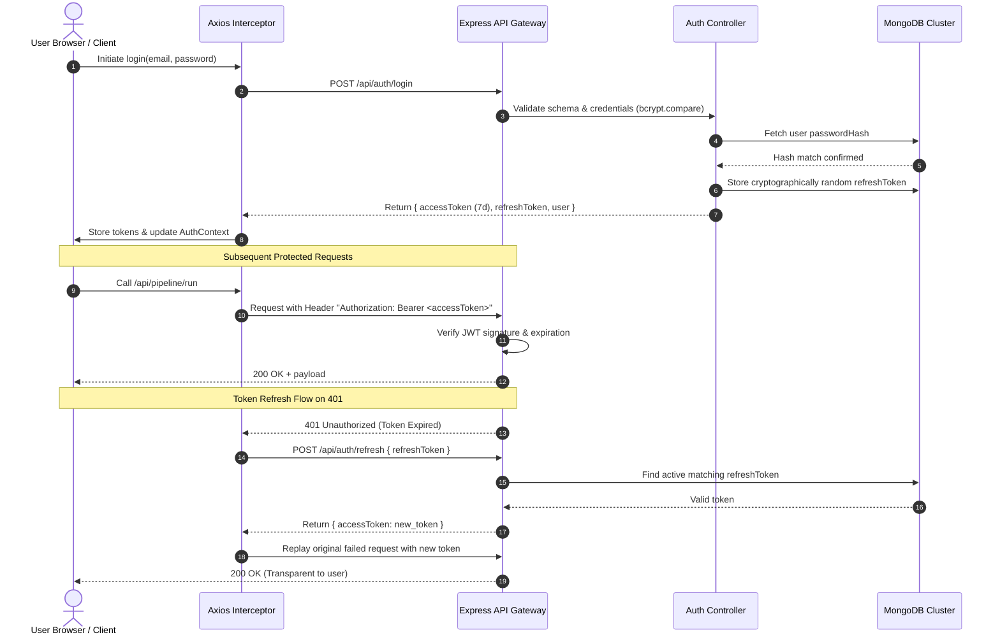

# ApplyForge Authentication & Security Architecture

[← Back to Documentation Hub](README.md) • [Architecture](ARCHITECTURE.md) • [API Reference](API.md) • [Setup Guide](SETUP.md)

---

## 1. Security Architecture Principles

ApplyForge adheres to strict defense-in-depth principles across client, server, and storage layers:

1. **Zero Trust Authorization**: No client-side claims or roles are trusted implicitly; every state-modifying request validates ownership at the database query boundary.
2. **Minimal Privilege & Data Isolation**: Multi-tenant database records are scoped strictly to the authenticated `user._id`.
3. **Payload Sanitization**: Binary file uploads are validated via magic-byte inspection before touching parsers or external object storage.
4. **Resilient Token Cycling**: Short-lived access tokens combined with revocable database-persisted refresh tokens.

---

## 2. Authentication System Specification



### 2.1 Token Specifications

| Parameter | Access Token | Refresh Token |
| :--- | :--- | :--- |
| **Format** | JSON Web Token (JWT) | Opaque Cryptographic String (Hex) |
| **Algorithm** | HMAC-SHA256 (`HS256`) | `crypto.randomBytes(40).toString('hex')` |
| **Lifespan** | 7 Days (Configurable via `JWT_EXPIRES_IN`) | 30 Days (Revocable) |
| **Storage (Client)** | In-Memory / Local Storage | Secure Storage / HTTP Client Context |
| **Storage (Server)** | Stateless verification | MongoDB `users.refreshTokens` collection |
| **Claims** | `{ id, email, iat, exp }` | Scoped token hash + creation audit |

### 2.2 Password Security
- **Hashing Engine**: `bcryptjs`
- **Salt Work Factor**: 10 rounds
- **Complexity Requirements**: Minimum 8 characters, at least one uppercase letter, one lowercase letter, one number, and one special character (enforced via Zod schema on frontend and Joi validation on backend).

---

## 3. Network & HTTP Security Controls

### 3.1 Content Security Policy (CSP) & Helmet
The Express server utilizes `helmet` to apply industry-standard HTTP security headers:

```javascript
app.use(
  helmet({
    contentSecurityPolicy: {
      directives: {
        defaultSrc: ["'self'"],
        scriptSrc: ["'self'", "'unsafe-inline'"],
        styleSrc: ["'self'", "'unsafe-inline'", 'https://fonts.googleapis.com'],
        fontSrc: ["'self'", 'https://fonts.gstatic.com'],
        imgSrc: ["'self'", 'data:', 'https://res.cloudinary.com', 'https://*.googleusercontent.com'],
        connectSrc: ["'self'", 'https://applyforge-api.onrender.com', 'https://generativelanguage.googleapis.com'],
        frameAncestors: ["'none'"],
      },
    },
    crossOriginEmbedderPolicy: false,
    crossOriginResourcePolicy: { policy: 'cross-origin' },
  })
);
```

### 3.2 CORS Whitelisting
Cross-Origin Resource Sharing (CORS) enforces an explicit origin allowlist with support for wildcard preview deployments:

```javascript
const allowedOrigins = [
  'http://localhost:5173',
  'http://localhost:3000',
  'https://applyforge.vercel.app',
  /^https:\/\/applyforge-[a-z0-9]+-nzaman7878s-projects\.vercel\.app$/,
];
```

### 3.3 Rate Limiting
Configured using `express-rate-limit` with draft-7 headers (`RateLimit-Policy`, `RateLimit-Limit`, `RateLimit-Remaining`, `RateLimit-Reset`):

- **Global Limiter**: 100 requests per 15-minute sliding window per IP.
- **Authentication Limiter**: 5 requests per 15-minute sliding window per IP applied to `/api/auth/login` and `/api/auth/register` to mitigate brute-force attacks.

---

## 4. File Upload Sanitization & Magic Byte Inspection

Untrusted file uploads present significant risks, including MIME spoofing and arbitrary code execution. ApplyForge implements deep byte-level inspection before processing:

```mermaid
graph TD
    Upload[File Upload via Multer] --> SizeCheck{File Size <= 5MB?}
    SizeCheck -->|No| RejectSize[Reject 400: File size exceeds 5MB limit]
    SizeCheck -->|Yes| MagicCheck{Magic Byte Inspection}
    MagicCheck -->|"%PDF-" 0x25 0x50 0x44 0x46| AcceptPDF[Valid PDF -> pdf-parse]
    MagicCheck -->|"PK\x03\x04" 0x50 0x4B 0x03 0x04| AcceptDOCX[Valid DOCX (ZIP container) -> mammoth]
    MagicCheck -->|Spoofed or Corrupted| RejectMagic[Reject 400: Invalid file signature / Spoofed MIME type]
```

---

## 5. Tenant Data Isolation

Every application, resume, and pipeline execution is bound to the owner's `userId`. All Mongoose mutations and queries enforce ownership:

```javascript
// Example: Safe Application Deletion
const application = await Application.findOneAndDelete({
  _id: req.params.id,
  user: req.user.id, // Strictly limits deletion to authenticated user
});

if (!application) {
  return res.status(404).json({ success: false, message: 'Application not found or unauthorized' });
}
```

---

## 6. Container & Runtime Security

- **Non-Root Execution**: `server/Dockerfile` runs as user `node` (`USER node`), preventing privilege escalation inside container environments.
- **Clean Alpine Footprint**: Minimal base image (`node:20-alpine`) reduces CVE attack surfaces.
- **Automated Healthchecks**: Built-in container health probes poll `/api/health` every 30 seconds.

---

*ApplyForge &copy; 2026. Document revision 1.2.0.*
