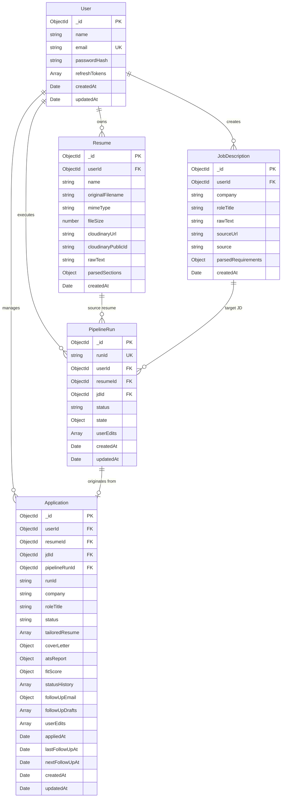

# ApplyForge Database Architecture & Data Models

[← Back to Documentation Hub](README.md) • [Architecture](ARCHITECTURE.md) • [API Reference](API.md) • [Setup Guide](SETUP.md)

---

## 1. Overview

ApplyForge utilizes **MongoDB** as its primary document store, managed through **Mongoose ODM**. MongoDB's flexible JSON-native document model is ideally suited for storing heterogeneous document parsing structures, variable-length resume bullet points, LangGraph pipeline checkpoints, and full-text job descriptions.

---

## 2. Entity-Relationship Diagram (ERD)



---

## 3. Detailed Model Schemas

### 3.1 User Model (`server/src/models/User.js`)
Stores candidate identity, credential hashes, and active refresh tokens.

```javascript
{
  name: { type: String, required: true, trim: true },
  email: { type: String, required: true, unique: true, lowercase: true, index: true },
  passwordHash: { type: String, required: true },
  refreshTokens: [
    {
      token: { type: String, required: true },
      createdAt: { type: Date, default: Date.now },
      expiresAt: { type: Date }
    }
  ],
  createdAt: { type: Date, default: Date.now },
  updatedAt: { type: Date, default: Date.now }
}
```

### 3.2 Resume Model (`server/src/models/Resume.js`)
Stores candidate resumes, Cloudinary metadata, raw text, and extracted career sections.

```javascript
{
  userId: { type: ObjectId, ref: 'User', required: true, index: true },
  name: { type: String, required: true },
  originalFilename: { type: String },
  mimeType: { type: String, enum: ['application/pdf', 'application/vnd.openxmlformats-officedocument.wordprocessingml.document'] },
  fileSize: { type: Number },
  cloudinaryUrl: { type: String },
  cloudinaryPublicId: { type: String },
  rawText: { type: String },
  parsedSections: {
    contact: {
      name: String,
      email: String,
      phone: String,
      location: String,
      linkedin: String,
      github: String,
      website: String
    },
    summary: String,
    skills: [String],
    experience: [
      {
        company: String,
        title: String,
        startDate: String,
        endDate: String,
        current: Boolean,
        location: String,
        description: String,
        bullets: [String]
      }
    ],
    education: [
      {
        institution: String,
        degree: String,
        fieldOfStudy: String,
        startDate: String,
        endDate: String,
        gpa: String
      }
    ],
    certifications: [
      {
        name: String,
        issuer: String,
        date: String,
        url: String
      }
    ]
  },
  createdAt: { type: Date, default: Date.now }
}
```

### 3.3 JobDescription Model (`server/src/models/JobDescription.js`)
Captures targeted job descriptions, live scraped links, and structured requirements.

```javascript
{
  userId: { type: ObjectId, ref: 'User', required: true, index: true },
  company: { type: String, required: true, trim: true },
  roleTitle: { type: String, required: true, trim: true },
  rawText: { type: String, required: true },
  sourceUrl: { type: String, default: null },
  source: { type: String, enum: ['paste', 'url', 'extension', 'sample'], default: 'paste' },
  parsedRequirements: {
    requiredSkills: [String],
    niceToHave: [String],
    experienceYears: String,
    qualifications: [String]
  },
  createdAt: { type: Date, default: Date.now }
}
```

### 3.4 PipelineRun Model (`server/src/models/PipelineRun.js`)
Persists LangGraph execution state, thread identifiers, checkpointed channels, and editorial status.

```javascript
{
  runId: { type: String, required: true, unique: true, index: true },
  userId: { type: ObjectId, ref: 'User', required: true, index: true },
  resumeId: { type: ObjectId, ref: 'Resume', required: true },
  jdId: { type: ObjectId, ref: 'JobDescription', required: true },
  status: {
    type: String,
    enum: ['pending', 'running', 'awaiting_review', 'saved', 'failed'],
    default: 'pending',
    index: true
  },
  state: { type: mongoose.Schema.Types.Mixed, default: {} },
  userEdits: [
    {
      field: String,
      original: String,
      edited: String,
      feedback: String,
      timestamp: { type: Date, default: Date.now }
    }
  ],
  createdAt: { type: Date, default: Date.now },
  updatedAt: { type: Date, default: Date.now }
}
```

### 3.5 Application Model (`server/src/models/Application.js`)
Central entity for the candidate's personal CRM, tracking stage progression and follow-up schedules.

```javascript
{
  userId: { type: ObjectId, ref: 'User', required: true, index: true },
  company: { type: String, required: true, trim: true },
  roleTitle: { type: String, required: true, trim: true },
  status: {
    type: String,
    enum: ['wishlist', 'applied', 'interviewing', 'offer', 'rejected'],
    default: 'wishlist',
    index: true
  },
  tailoredResume: { type: mongoose.Schema.Types.Mixed, default: () => [] },
  coverLetter: {
    subject: String,
    body: String,
    keyThemes: [String]
  },
  atsReport: {
    overallScore: Number,
    matchedKeywords: [mongoose.Schema.Types.Mixed],
    missingKeywords: [mongoose.Schema.Types.Mixed]
  },
  fitScore: {
    score: Number,
    tier: String,
    summary: String,
    gaps: [mongoose.Schema.Types.Mixed],
    strengths: [String]
  },
  statusHistory: [
    {
      fromStatus: String,
      toStatus: String,
      changedAt: { type: Date, default: Date.now },
      note: String
    }
  ],
  followUpEmail: {
    subject: String,
    body: String,
    strategy: String,
    draftedAt: Date
  },
  followUpDrafts: [
    {
      subject: String,
      body: String,
      strategy: String,
      tone: String,
      draftedAt: { type: Date, default: Date.now }
    }
  ],
  userEdits: [
    {
      section: String,
      original: String,
      edited: String,
      feedback: String,
      createdAt: { type: Date, default: Date.now }
    }
  ],
  appliedAt: { type: Date },
  lastFollowUpAt: { type: Date },
  nextFollowUpAt: { type: Date, index: true },
  notes: { type: String, default: '' },
  createdAt: { type: Date, default: Date.now },
  updatedAt: { type: Date, default: Date.now }
}
```

---

## 4. Indexing & Query Optimization

| Model | Index Fields | Purpose |
| :--- | :--- | :--- |
| `User` | `{ email: 1 }` (Unique) | O(1) user lookups during authentication. |
| `Resume` | `{ userId: 1, createdAt: -1 }` | Fast candidate resume listing ordered by recency. |
| `JobDescription` | `{ userId: 1, createdAt: -1 }` | Fast candidate JD listing. |
| `PipelineRun` | `{ runId: 1 }` (Unique) | Immediate O(1) graph state retrieval by run ID. |
| `Application` | `{ userId: 1, status: 1 }` | Compound index powering Kanban board columns. |
| `Application` | `{ userId: 1, nextFollowUpAt: 1 }` | Rapid filtering for overdue follow-up reminder alerts. |

---

## 5. Connection Management & Resilience

Implemented in `server/src/config/database.js`:

```javascript
const mongoose = require('mongoose');

const connectDB = async () => {
  const options = {
    maxPoolSize: 10,
    serverSelectionTimeoutMS: 5000,
    socketTimeoutMS: 45000,
  };

  try {
    const conn = await mongoose.connect(process.env.MONGODB_URI, options);
    console.log(`[Database] MongoDB Connected: ${conn.connection.host}`);
  } catch (error) {
    console.error(`[Database Error] Connection failed: ${error.message}`);
    process.exit(1);
  }
};
```

---

*ApplyForge &copy; 2026. Document revision 1.2.0.*
