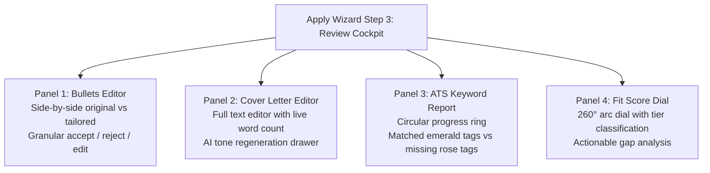

# ApplyForge UI/UX Design System Specification

[← Back to Documentation Hub](README.md) • [Architecture](ARCHITECTURE.md) • [Frontend Guide](FEATURE_DEVELOPMENT.md) • [Setup Guide](SETUP.md)

---

## 1. Design Philosophy & Aesthetic

ApplyForge is engineered for high-performing technical candidates. The design system is:

1. **Dark-Mode First**: Built on deep slate tones (`slate-950` to `slate-800`) to minimize visual fatigue during intense job hunting workflows.
2. **Glassmorphic Precision**: Subtle translucency (`bg-slate-900/80 backdrop-blur-md`) and fine border structures (`border-slate-800/80`) that organize complex multi-stage data without visual noise.
3. **High Information Density with Clarity**: Clean metrics, categorized tags, and side-by-side diff viewers that give candidates maximum situational awareness.
4. **Accessible & Responsive**: Meets WCAG 2.1 AA contrast standards, supports full keyboard navigation (`Ctrl+Enter`, `Escape`), and scales seamlessly from mobile screens to 4K displays.

---

## 2. Design Tokens & Color System

Defined in `client/src/styles/tokens.css` and integrated with Tailwind CSS:

### 2.1 Core Palette

| Role | Token / Utility | Hex Value | Application |
| :--- | :--- | :--- | :--- |
| **Canvas Background** | `slate-950` | `#020617` | Root application background. |
| **Surface Base** | `slate-900` | `#0f172a` | Container surfaces and modal backdrops. |
| **Card & Panel Fill** | `slate-800` | `#1e293b` | Review panels, Kanban cards, stat cards. |
| **Subtle Border** | `slate-800/80` | `#1e293b` (alpha) | Card borders and panel dividers. |
| **Accent Primary** | `blue-600` / `blue-500` | `#2563eb` / `#3b82f6` | Primary action buttons, active navigation pills. |
| **Success / Matched** | `emerald-500` | `#10b981` | ATS matched keywords, approved states, 80+ fit scores. |
| **Warning / Attention** | `amber-500` | `#f59e0b` | Follow-up due warnings, 60–79 moderate fit scores. |
| **Danger / Missing** | `rose-500` | `#f43f5e` | Missing ATS keywords, reject actions, errors. |

---

## 3. Typography Hierarchy

ApplyForge uses **Inter** (Google Fonts) with optimal character tracking:

```css
font-family: 'Inter', system-ui, -apple-system, BlinkMacSystemFont, 'Segoe UI', Roboto, sans-serif;
```

| Element | Size | Weight | Tracking | Usage |
| :--- | :--- | :--- | :--- | :--- |
| **Display Heading** | `3.75rem` (60px) | `800` (Extrabold) | `-0.025em` | Landing page hero title. |
| **Page Title (H1)** | `1.875rem` (30px) | `700` (Bold) | `-0.02em` | Section headers, Review Cockpit title. |
| **Card Heading (H2)** | `1.25rem` (20px) | `600` (Semibold) | `-0.01em` | Panel titles, modal headers. |
| **Body Text** | `0.875rem` (14px) | `400` (Regular) | `normal` | General paragraph copy, bullet points. |
| **Caption / Meta** | `0.75rem` (12px) | `500` (Medium) | `0.01em` | Timestamps, status badges, tag counters. |

---

## 4. Core UI Components

### 4.1 Buttons (`client/src/components/ui/Button.jsx`)
- **Variants**:
  - `primary`: Solid blue fill (`bg-blue-600 hover:bg-blue-500 text-white shadow-lg shadow-blue-500/20`).
  - `secondary`: Slate container (`bg-slate-800 hover:bg-slate-700 text-slate-200 border border-slate-700`).
  - `ghost`: Transparent hover (`hover:bg-slate-800/60 text-slate-400 hover:text-white`).
  - `danger`: Red outline/fill (`bg-rose-500/10 hover:bg-rose-500 text-rose-400 hover:text-white border border-rose-500/30`).
- **States**: `isLoading` spinner state, disabled state with opacity reduction and pointer-events prevention.

### 4.2 Radial Score Dial (`FitScore.jsx`)
- Custom SVG radial progress arc sweeping 260° with dynamic color gradient:
  - `80 – 100`: `#10b981` (Emerald)
  - `60 – 79`: `#f59e0b` (Amber)
  - `0 – 59`: `#f43f5e` (Rose)

### 4.3 Circular Progress Ring (`ATSReport.jsx`)
- SVG circle gauge rendering exact keyword match percentage with centered numerical readout.

---

## 5. Review Cockpit Layout Specifications



---

## 6. Kanban Board Specifications (`@dnd-kit`)

- **Columns**: 5 fixed columns (`Wishlist`, `Applied`, `Interviewing`, `Offer`, `Rejected`).
- **Drag Interaction**:
  - Pointer distance threshold: `5px` to distinguish clicks from drags.
  - Active card elevates with `scale(1.03)` transform, drop shadow, and reduced opacity placeholder.
  - Target column highlights with glowing border (`border-blue-500/50`).
- **Optimistic UI**: Column movements update React state instantly while dispatching `PATCH /api/applications/:id` in the background.

---

## 7. Accessibility & Keyboard Shortcuts

- **Focus Trapping**: All modals implement `useFocusTrap` to trap focus within dialog boundaries and return focus on close.
- **Shortcuts**:
  - `Ctrl + Enter` (or `Cmd + Enter`): Approve Application / Submit Modal.
  - `Escape`: Close active modal or cancel inline editing.
  - `Tab / Shift + Tab`: Cycle focus through interactive form controls.

---

*ApplyForge &copy; 2026. Document revision 1.2.0.*
