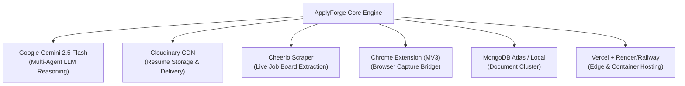

# ApplyForge Third-Party Integrations & Ecosystem Guide

[← Back to Documentation Hub](README.md) • [Architecture](ARCHITECTURE.md) • [API Reference](API.md) • [Setup Guide](SETUP.md)

---

## 1. Overview of Integrations

ApplyForge connects modern developer tools, AI platforms, cloud storage providers, and browser APIs into a cohesive workflow:



---

## 2. Google Gemini AI Engine

### 2.1 Configuration & Model Parameters
ApplyForge interfaces with Google Gemini through `@google/generative-ai` and `@langchain/google-genai`:

- **Model Identifier**: `gemini-2.5-flash` (Configurable via `LLM_MODEL`)
- **Generation Temperature**: `0.7` (Balances creative narrative flow with factual grounding)
- **Max Output Tokens**: `2048`
- **Output Schema**: Structured JSON mode using strict markdown elimination prompts (`JSON.parse` extraction).

### 2.2 Safety & Fallback Integration
When API quota limits or service disruptions occur, ApplyForge's deterministic fallback engine activates automatically across all agents:
- `generateTailoringHeuristic(state)`: Contextual keyword injection into original bullets.
- `generateCoverLetterHeuristic(state)`: Template-based bespoke cover letter generation.
- `generateFitScoreHeuristic(state)`: Exact TF-IDF and weighted keyword overlap ratio calculation.
- `generateFollowUpHeuristic(state)`: Timing-calibrated recruiter outreach matrix.

---

## 3. Cloudinary Asset Management

Candidate resumes (PDF/DOCX) are sanitized, uploaded to Cloudinary, and served securely:

```javascript
// server/src/services/cloudinary.js
const cloudinary = require('cloudinary').v2;

cloudinary.config({
  cloud_name: process.env.CLOUDINARY_CLOUD_NAME,
  api_key: process.env.CLOUDINARY_API_KEY,
  api_secret: process.env.CLOUDINARY_API_SECRET,
  secure: true,
});

exports.uploadResumeStream = (buffer, filename) => {
  return new Promise((resolve, reject) => {
    const uploadStream = cloudinary.uploader.upload_stream(
      {
        folder: 'applyforge/resumes',
        resource_type: 'raw',
        public_id: `${Date.now()}_${filename.replace(/\.[^/.]+$/, '')}`,
      },
      (error, result) => {
        if (error) return reject(error);
        resolve(result);
      }
    );
    uploadStream.end(buffer);
  });
};
```

---

## 4. Live Job Scraper Engine (Cheerio + Axios)

### 4.1 Anti-Bot Mitigation
- **User-Agent Rotation**: Cycles through verified desktop browser signatures (Chrome, Firefox, Safari on Windows/macOS).
- **DOM Sanitization**: Statically strips script tags, iframe embeds, and navigation chrome before extracting text.

### 4.2 Platform Selectors

| Platform | Title Selector | Company Selector | Description Body Selector |
| :--- | :--- | :--- | :--- |
| **LinkedIn** | `.job-details-jobs-unified-top-card__job-title` | `.jobs-unified-top-card__company-name` | `.jobs-description` |
| **Greenhouse** | `.job__title`, `.app-title` | `.job__company`, `.company-name` | `#content` |
| **Lever** | `.posting-headline h2` | `.main-header-logo` | `.section-wrapper` |
| **Indeed** | `.jobsearch-JobInfoHeader-title` | `[data-company-name="true"]` | `#jobDescriptionText` |
| **Naukri** | `.styles_jd-header-title__rZwM1` | `.styles_jd-header-comp-name__MvqAI` | `.styles_JDC__dang-inner-html` |

---

## 5. Chrome Browser Extension (Manifest V3)

The extension enables candidates to ingest job listings with 1 click while browsing LinkedIn or Naukri:

- **Manifest V3 Specification**: Uses `service_worker: background.js` and declarative storage permissions.
- **Session Bridge (`⚡ Sync from Tab`)**: Harvests the candidate's active JWT from `localStorage` in the web application tab into `chrome.storage.local`.
- **Apply Wizard Handoff**: Posts the captured JD text via `POST /api/jds` and directs the active browser tab to `http://localhost:5173/apply?jdId=<new_id>`.

---

## 6. Hosting & CI/CD Integrations

- **GitHub Actions (`.github/workflows/ci.yml`)**: Automated pipeline verifying Node 20 environment, code linting, backend tests, and Vite production bundle compilation on every PR.
- **Vercel (`vercel.json`)**: Configured for edge SPA route rewrites (`{"source": "/(.*)", "destination": "/index.html"}`) and static asset caching.
- **Render (`render.yaml`) & Railway (`railway.json`)**: Blueprints for zero-downtime containerized Express deployments with automated health checks.

---

*ApplyForge &copy; 2026. Document revision 1.2.0.*
