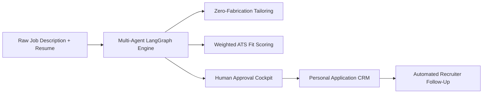

# ApplyForge Product Requirements Document (PRD)

[← Back to Documentation Hub](README.md) • [Architecture](ARCHITECTURE.md) • [Implementation Plan](IMPLEMENTATION_PLAN.md) • [Design System](DESIGN.md)

---

## 1. Executive Summary & Vision

**ApplyForge** is an intelligent, multi-agent job application copilot engineered to eliminate the manual friction of technical job hunting. By automating resume tailoring, ATS keyword alignment, cover letter generation, and post-submission lifecycle management through an autonomous multi-agent pipeline, ApplyForge empowers candidates to submit highly tailored, ATS-optimized applications in under 2 minutes—while maintaining human control and preserving authentic candidate voice.

---

## 2. Problem Statement & User Pain Points

1. **The ATS Black Hole**: Up to 75% of resumes submitted to modern Applicant Tracking Systems (Workday, Greenhouse, Taleo) are rejected before human eyes review them due to missing semantic keywords and misaligned skill phrasing.
2. **Exhausting Manual Tailoring**: Hand-tailoring a resume and cover letter for each unique job description requires 45–90 minutes, leading to applicant fatigue and inconsistent quality.
3. **The "AI Fluff" Trap**: Standard generative AI tools (ChatGPT, Claude) produce generic, hyperbolic prose (*"passionate team player with visionary leadership"*) or fabricate experience, destroying credibility.
4. **CRM Disconnection**: Candidates lose track of submissions across fragmented spreadsheets and email threads, missing crucial follow-up windows that dramatically increase callback rates.

---

## 3. User Personas

| Persona | Role / Background | Primary Needs | Key Pain Point |
| :--- | :--- | :--- | :--- |
| **Alex (The Full-Stack Engineer)** | Mid-level developer with 3 years experience applying to high-growth tech startups. | Speed, ATS keyword verification, highlighting specific frameworks (React, Docker, Node). | Gets filtered out by recruiter filters despite having the core technical competencies. |
| **Priya (The Career Switcher)** | Transitioning from data analysis into backend engineering. | Re-framing transferable skills, strong qualitative cover letters, and actionable gap analysis. | Struggles to map prior domain achievements to technical software engineering criteria. |
| **Marcus (The Active Job Hunter)** | Applying to 20+ roles per week across multiple job platforms (LinkedIn, Naukri, Indeed). | 1-click capture, structured Kanban tracking, automated overdue follow-up alerts. | Chaos managing response timelines and following up with recruiters. |

---

## 4. Product Value Proposition

- **Speed**: Reduces application customization time from 60 minutes to <2 minutes.
- **Accuracy**: Weighted ATS keyword extraction ensures core requirements are naturally reinforced in bullet points.
- **Authenticity**: Adaptive voice learning engine studies approved edits to replicate the candidate's personal tone without hallucinations.
- **Human In The Loop**: Mandatory checkpoint ensures candidates inspect every bullet before saving.

---

## 5. Functional Requirements (FR)

### FR-1: Document Ingestion & Parsing
- System shall parse PDF and DOCX files up to 5MB using `pdf-parse` and `mammoth`.
- Heuristic regex extractor must extract Contact, Summary, Experience, Education, Skills, and Certifications.
- Binary files must undergo magic-byte signature validation (`%PDF-`, `PK\x03\x04`).

### FR-2: Job Description Parsing & Web Scraping
- System shall support raw text paste, example templates, and live URL scraping (LinkedIn, Greenhouse, Lever, Indeed, Naukri).
- Parser must extract Required Skills, Nice-to-Have Skills, Experience Years, and Minimum Qualifications.

### FR-3: Multi-Agent Tailoring Pipeline (LangGraph)
- Pipeline must orchestrate parallel execution of Resume Tailoring Node and ATS Keyword Node.
- Resume bullets must adhere to action-oriented XYZ format (*Accomplished X, measured by Y, doing Z*).
- System must strictly forbid fabrication of experience, metrics, or credentials.

### FR-4: Human-in-the-Loop Review Cockpit
- Graph must pause at `__human_interrupt__` with status `awaiting_review`.
- Cockpit must provide side-by-side original vs tailored bullet comparison, per-bullet accept/reject/edit actions, rich cover letter editor, ATS keyword tag matrix, and 260° radial fit score dial.
- Candidate must be able to submit revisions and loop back through tailoring nodes.

### FR-5: Application Tracker CRM
- CRM board must provide 5 lifecycle stages: `Wishlist`, `Applied`, `Interviewing`, `Offer`, `Rejected`.
- Stages must support fluid drag-and-drop interaction with optimistic updates and status transition auditing.
- Follow-up reminder banner must surface overdue alerts (`nextFollowUpAt <= now`).

### FR-6: Analytics & Intelligence Dashboard
- Real-time KPI stat cards: `Total Applied`, `Response Rate`, `Avg Fit Score`, `Open Follow-ups`.
- 12-week velocity area chart and fit-score vs callback rate correlation bar chart.

### FR-7: Chrome Extension (Manifest V3)
- 1-click capture from LinkedIn and Naukri job postings.
- Token harvesting (`⚡ Sync from Tab`) and instant Apply wizard pre-fill.

### FR-8: Recruiter Follow-Up Copilot
- AI-crafted follow-up emails calibrated to elapsed days (5–7d courtesy, 8–14d inquiry, >14d re-engagement) and interview status.
- Heuristic fallback template matrix when LLM is unavailable.

---

## 6. Non-Functional Requirements (NFR)

- **Performance**: End-to-end agent tailoring pipeline completes in <10 seconds; sub-second production bundle builds (695ms).
- **Security**: Strict Helmet CSP headers, wildcard CORS whitelisting, draft-7 rate limiting, and bcrypt password hashing.
- **Reliability**: 100% deterministic fallback heuristics on all AI agent nodes.
- **Accessibility**: WCAG 2.1 AA compliance, focus trapping, keyboard shortcuts (`Ctrl+Enter`, `Escape`).

---

*ApplyForge &copy; 2026. Document revision 1.2.0.*
