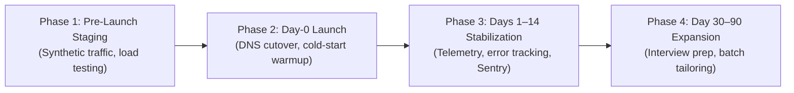

# ApplyForge Production Launch Roadmap & Rollout Plan

[← Back to Documentation Hub](README.md) • [Go-Live Sign-Off](PRODUCTION_GO_LIVE_SIGNOFF.md) • [Architecture](ARCHITECTURE.md) • [Setup](SETUP.md)

---

## 1. Overview & Launch Phasing

The production launch of ApplyForge follows a phased, risk-mitigated rollout strategy spanning Pre-Launch Staging, Day-0 Cutover, Post-Launch Stabilization, and Future Product Horizons.



---

## 2. Launch Execution Timeline

### Phase 1: Pre-Launch Staging (T-48 Hours to T-0)
- **Database Index Pre-computation**: Run index builds on MongoDB production cluster for `User.email`, `Application.userId_status`, and `PipelineRun.runId`.
- **Environment Verification**: Audit all production secrets via `server/src/config/env.js` (Joi validation) on staging instances.
- **Simulated Multi-Agent Load**: Execute 50 concurrent pipeline runs using synthetic resumes and JDs to verify LangGraph concurrency limits and Gemini API quota handling.
- **Docker Image Signing**: Tag production Docker image `applyforge-api:v1.2.0` and publish to container registry.

### Phase 2: Day-0 Production Cutover
1. **Database Connection Verification**: Warm up connection pool (`maxPoolSize: 10`) against MongoDB production replica set.
2. **Backend API Deployment**:
   - Deploy `server/Dockerfile` to Render / Railway cluster.
   - Verify automated healthcheck returns `status: "ok"` from `GET /api/health`.
3. **Frontend Edge Deployment**:
   - Push Vite production build (`dist/`) to Vercel Global Edge Network.
   - Verify SPA route rewrites for deep-linked paths (`/dashboard`, `/tracker`, `/apply`).
4. **SSL / TLS & DNS Propagation**:
   - Validate wildcard SSL certificates (`*.vercel.app`, custom domains).
   - Verify CORS origin headers reject arbitrary third-party origins while accepting configured web domains.
5. **Sanity E2E Smoke Test**:
   - Perform end-to-end user registration, PDF resume upload, JD scrape, tailoring run, human approval, and follow-up draft generation on production.

### Phase 3: Post-Launch Stabilization (Days 1–14)
- **Continuous Health Telemetry**: Monitor HTTP status code distribution (alerting on 5xx spike > 0.5%).
- **Gemini Rate Limit & Quota Monitoring**: Track LLM error fallbacks; adjust `LLM_TEMPERATURE` or request quota increases if required.
- **Database Query Latency**: Monitor MongoDB Atlas index hit ratios and slow query logs.
- **Chrome Extension Store Release**: Submit `extension/` to the Chrome Web Store for public developer availability.

---

## 3. 30 / 60 / 90 Day Product Expansion Roadmap

```mermaid
timeline
    title ApplyForge Product Roadmap Horizon
    section 30 Days : High-Impact Expansion
      Batch JD Tailoring : Tailor multiple applications simultaneously
      Interview Prep Agent : Generate role-specific technical Q&A questions
    section 60 Days : Automation & Integrations
      MCP Email Sender : Direct mailto and SendGrid/Resend integration via MCP
      Naukri 1-Click Apply : Deep browser extension auto-fill automation
    section 90 Days : Career Intelligence
      Salary Negotiation Agent : Benchmark compensation offers against market data
      Peer Collaborative Workspace : Share application dossiers with mentors
```

---

## 4. Disaster Recovery & Rollback Runbook

### Rollback Triggers:
- Production 5xx error rate exceeds 2% over a 5-minute window.
- Database connection pool exhaustion lasting > 60 seconds.
- Critical security vulnerability identified in dependencies.

### Rollback Execution Steps:
1. **Frontend Instant Rollback**: In Vercel Dashboard, select previous instant deployment snapshot and click **"Promote to Production"** (< 5 seconds cutover).
2. **Backend Container Rollback**: In Render/Railway, redeploy previous Git commit tag (`c8c3b0c` or prior release) without re-building dependencies.
3. **Database Point-in-Time Recovery (PITR)**: If schema corruption occurs, restore MongoDB Atlas continuous backup to T-15 minutes.
4. **Incident Post-Mortem**: Document root cause, impact duration, and preventative action items in `docs/DEBUGGING.md`.

---

*ApplyForge &copy; 2026. Document revision 1.2.0.*
