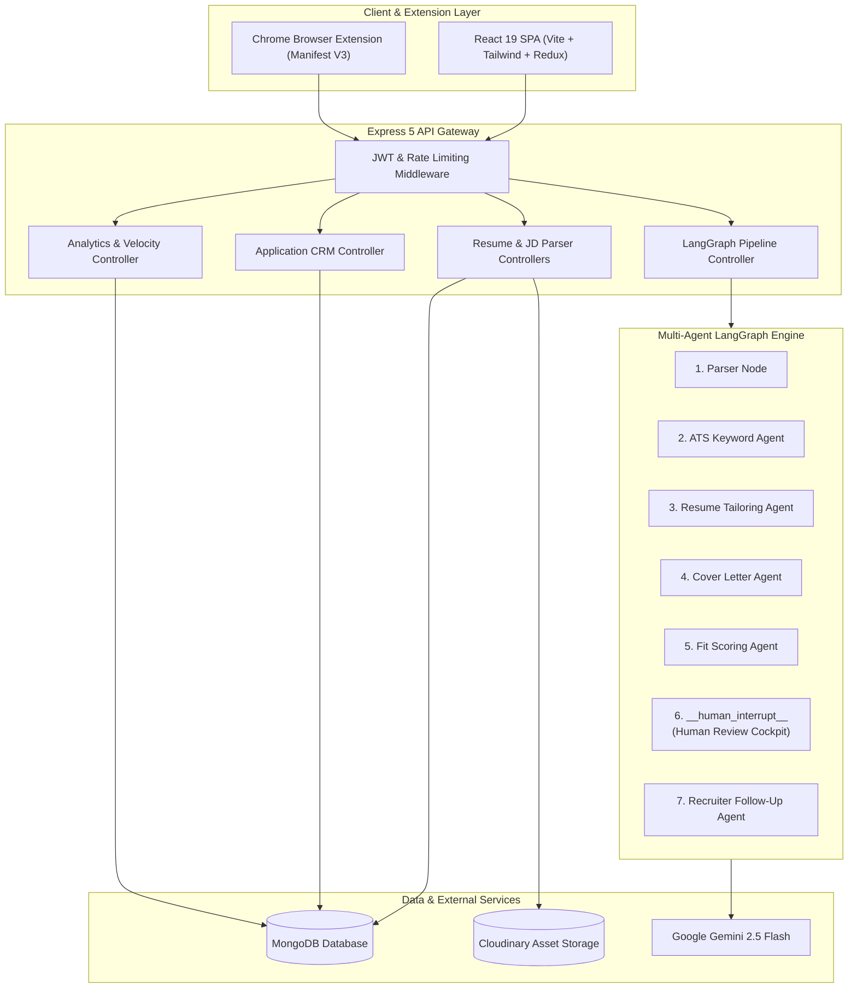

# ApplyForge Documentation Hub

Welcome to the **ApplyForge** technical documentation repository. This hub serves as the definitive reference for engineering, architecture, product specifications, operations, security, and developer workflows.

---

## 🧭 Documentation Navigation Matrix

| Document | Category | Target Audience | Description |
| :--- | :--- | :--- | :--- |
| [**ARCHITECTURE.md**](ARCHITECTURE.md) | System Design | Engineers, Architects | Multi-agent LangGraph DAG topology, parallel execution, human-in-the-loop checkpoints, and data pipelines. |
| [**API.md**](API.md) | Reference | Full-Stack & Integration Devs | Complete REST API specification with endpoints, request bodies, query params, headers, and response schemas. |
| [**AUTH_SECURITY.md**](AUTH_SECURITY.md) | Security & Compliance | Security Engineers, Devs | JWT/Refresh token authentication, password hashing, CSP headers, rate limiting, and binary upload sanitization. |
| [**DATABASE.md**](DATABASE.md) | Data Architecture | Backend & DBA Engineers | MongoDB schemas, Mongoose models, data relationships, indexing strategies, and connection pooling. |
| [**DEBUGGING.md**](DEBUGGING.md) | Operations & Support | All Developers, SREs | Diagnostic runbooks, troubleshooting guide for Gemini fallbacks, token refresh loops, and parser errors. |
| [**DESIGN.md**](DESIGN.md) | UI / UX | Frontend Engineers, Designers | Design system tokens, color palettes, glassmorphism UI components, responsive layout, and WAI-ARIA accessibility. |
| [**FEATURE_DEVELOPMENT.md**](FEATURE_DEVELOPMENT.md) | Developer Guide | Contributors, Engineers | Step-by-step guide to adding agent nodes, REST controllers, UI components, and test-driven development workflows. |
| [**IMPLEMENTATION_PLAN.md**](IMPLEMENTATION_PLAN.md) | Roadmap & History | Engineering Leads, PMs | Complete 110-phase master roadmap across Epics A through K with atomic commit logs and delivery milestones. |
| [**INTEGRATIONS.md**](INTEGRATIONS.md) | Ecosystem | Integration Engineers | Third-party services: Google Gemini 2.5 Flash, Cloudinary asset storage, Cheerio live web scrapers, and Chrome MV3. |
| [**MCP.md**](MCP.md) | AI Tooling & Protocols | AI / ML Engineers | Model Context Protocol (MCP) integrations, Neon PostgreSQL server tools, database orchestration, and tool schemas. |
| [**PRD.md**](PRD.md) | Product Management | Product Managers, Stakeholders | Product Requirements Document: Problem statement, user personas, functional specs, user stories, and KPIs. |
| [**PRODUCTION_GO_LIVE_SIGNOFF.md**](PRODUCTION_GO_LIVE_SIGNOFF.md) | Release Engineering | Tech Leads, DevOps, QA | Formal production verification checklist, security sign-off, performance audit, and release authorization. |
| [**PRODUCTION_LAUNCH_ROADMAP.md**](PRODUCTION_LAUNCH_ROADMAP.md) | Operations | DevOps, Tech Leads | Staged deployment procedures, zero-downtime rollback strategies, post-launch monitoring, and Day-0/30/90 milestones. |
| [**SETUP.md**](SETUP.md) | Onboarding | All Developers | Comprehensive local development setup, environment variables, Docker Compose, database seeding, and extension setup. |
| [**TESTING.md**](TESTING.md) | Quality Assurance | QA, Test Engineers, Devs | Comprehensive test strategy: unit, integration, and UI component tests, test commands reference, and CI/CD pipelines. |

---

## 🏗️ Architecture & System Overview



---

## 🚀 Quick Reference Guide

### Running Locally
```bash
# Clone and install dependencies
git clone https://github.com/nzaman7878/ApplyForge-Multi-Agent-Job-Application-Copilot.git
cd "ApplyForge  Multi Agent Job Application Copilot"
npm install && npm install -w client && npm install -w server

# Spin up MongoDB via Docker
npm run docker:up

# Seed demo dataset (24 realistic applications, 12-week velocity metrics)
npm run seed:dashboard -w server

# Run backend & frontend concurrently
npm run dev
```

### Running Test Suites
```bash
# Run all server tests (unit + integration + extension + follow-up)
npm test -w server

# Run client tests (Vitest + React Testing Library)
npm test -w client
```

For more setup instructions, consult [**SETUP.md**](SETUP.md).

---

## 🤝 Contributing & Standards

- **Code Style**: Strictly follows ESLint and Prettier rules defined at the monorepo root.
- **Commit Format**: All commits adhere to [Conventional Commits](https://www.conventionalcommits.org/) format (`feat:`, `fix:`, `docs:`, `test:`, `perf:`, `chore:`).
- **Branching Strategy**: Trunk-based development with linear git history.
- Read [**FEATURE_DEVELOPMENT.md**](FEATURE_DEVELOPMENT.md) before submitting pull requests.

---

*ApplyForge &copy; 2026 — Multi-Agent Job Application Copilot. Production Ready Engineering.*
