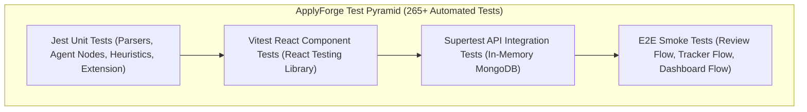

# ApplyForge Testing Strategy & Verification Guide

[← Back to Documentation Hub](README.md) • [Architecture](ARCHITECTURE.md) • [Setup Guide](SETUP.md) • [Debugging](DEBUGGING.md)

---

## 1. Testing Philosophy & Test Pyramid

ApplyForge enforces a rigorous testing strategy guaranteeing that all 110 implementation phases maintain high test coverage, deterministic execution, and zero regression:



- **Zero Mocking of Core Logic**: Heuristics, parsers, regex tokenizers, and schema validators are tested against real binary documents (PDF, DOCX) and dirty HTML payloads.
- **In-Memory Database Isolation**: Integration tests run against an ephemeral in-memory MongoDB instance (`mongodb-memory-server`), preventing cross-test pollution and ensuring tests run cleanly in any CI environment without external services.
- **Mocked External AI**: External Google Gemini API calls are mocked or verified via deterministic fallback heuristics to guarantee test stability and eliminate API cost/rate limits during CI runs.

---

## 2. Test Execution Commands Reference

### 2.1 Complete Test Suite Execution
```bash
# Run all server tests (Unit + Integration + Extension + Follow-Up)
npm test -w server

# Run all client component tests (Vitest)
npm test -w client
```

### 2.2 Granular Server Test Suites (`server/package.json`)

| Command | Suite Target | Description |
| :--- | :--- | :--- |
| `npm run test:auth -w server` | `tests/integration/auth.test.js` | User registration, login, rate limiting, and token refresh. |
| `npm run test:resume -w server` | `tests/unit/resumeModel.test.js` | Resume Mongoose schema, validation, and subdocument parsing. |
| `npm run test:upload -w server` | `tests/unit/uploadMiddleware.test.js` | Multer file type filtering, MIME validation, and 5MB size limit. |
| `npm run test:pdf -w server` | `tests/unit/pdfParser.test.js` | PDF text extraction using `pdf-parse`. |
| `npm run test:docx -w server` | `tests/unit/docxParser.test.js` | DOCX raw text extraction using `mammoth`. |
| `npm run test:section -w server` | `tests/unit/sectionExtractor.test.js` | Heuristic section classification (Contact, Skills, Experience, Education). |
| `npm run test:upload-endpoint -w server` | `tests/integration/resumeUpload.test.js` | `POST /api/resumes` endpoint verification with magic bytes. |
| `npm run test:get-resumes -w server` | `tests/integration/getResumes.test.js` | `GET /api/resumes` and `GET /api/resumes/:id`. |
| `npm run test:delete-resume -w server` | `tests/integration/deleteResume.test.js` | `DELETE /api/resumes/:id` with user ownership guard. |
| `npm run test:jd-model -w server` | `tests/unit/jdModel.test.js` | JobDescription schema and requirements parsing. |
| `npm run test:jd-parser -w server` | `tests/unit/jdParser.test.js` | Regex heuristic extractor for required vs nice-to-have skills. |
| `npm run test:create-jd -w server` | `tests/integration/createJD.test.js` | `POST /api/jds` endpoint. |
| `npm run test:jd-scraper -w server` | `tests/unit/jdScraper.test.js` | Cheerio web scraper with user-agent rotation across job boards. |
| `npm run test:jd-crud -w server` | `tests/integration/jdEndpoints.test.js` | Job description listing, detail, and deletion. |
| `npm run test:agent-state -w server` | `tests/unit/agentState.test.js` | LangGraph agent state channels and schema validation. |
| `npm run test:parser-node -w server` | `tests/unit/parserNode.test.js` | Parser Agent Node normalization and skill deduplication. |
| `npm run test:resume-tailoring -w server`| `tests/unit/resumeTailoringNode.test.js` | Resume Tailoring Node with mocked LLM and heuristic fallback. |
| `npm run test:ats-keyword -w server` | `tests/unit/atsKeywordNode.test.js` | Weighted ATS keyword scoring (3x required, 2x preferred, 1x bonus).|
| `npm run test:cover-letter -w server` | `tests/unit/coverLetterNode.test.js` | Cover letter agent synthesis and anti-cliché filters. |
| `npm run test:fit-scoring -w server` | `tests/unit/fitScoringNode.test.js` | 60/40 weighted fit scoring and qualitative gap analysis. |
| `npm run test:pipeline -w server` | `tests/unit/pipeline.test.js` | LangGraph DAG topology, edge transitions, and interrupt checkpoints.|
| `npm run test:pipeline-endpoints -w server`| `tests/integration/pipelineEndpoints.test.js`| Pipeline execution (`run`, `approve`, `edit`, `status`). |
| `npm run test:review-flow -w server` | `tests/integration/reviewFlow.test.js` | E2E smoke test: upload → paste JD → pipeline → review → approve. |
| `npm run test:application-model -w server`| `tests/unit/applicationModel.test.js` | Application CRM schema, status enum, and timing fields. |
| `npm run test:applications -w server` | `tests/integration/applicationEndpoints.test.js`| Application CRUD with pagination, filters, and isolation. |
| `npm run test:status-transition -w server`| `tests/unit/statusTransition.test.js`| CRM status state transitions and audit logging. |
| `npm run test:follow-up-due -w server`| `tests/integration/followUpDueEndpoint.test.js`| Overdue follow-up alert retrieval (`nextFollowUpAt <= now`). |
| `npm run test:tracker-flow -w server` | `tests/integration/trackerFlow.test.js` | E2E smoke test: create → move stages → follow-up → delete. |
| `npm run test:dashboard -w server` | `tests/integration/dashboardFlow.test.js` | Analytics summary, 12-week velocity, and score tiers. |
| `npm run test:voice-learning -w server` | `tests/unit/voiceLearning.test.js` | User edit diff collection and few-shot style injection. |
| `npm run test:extension -w server` | `tests/unit/browserExtension.test.js` | Chrome MV3 manifest, content script, popup UI, and JWT sync. |
| `npm run test:follow-up-draft -w server`| `tests/unit/followUpNode.test.js` | Recruiter follow-up email agent and endpoint. |

---

## 3. Client Component Testing (Vitest + React Testing Library)

Client test suites run in a simulated JSDOM environment with Redux and Router provider wrappers:

- `src/test/ATSReport.test.jsx`: Verifies circular progress ring, matched tags, and filter tabs.
- `src/test/BulletsEditor.test.jsx`: Tests side-by-side bullet comparisons, inline editing, and accept/reject actions.
- `src/test/KanbanBoard.test.jsx`: Tests 5-column Kanban layout and drag-and-drop column transitions.
- `src/test/FollowUpDraftModal.test.jsx`: Tests real-time draft customization, tone selection, and clipboard actions.
- `src/test/JDPasteForm.test.jsx`: Tests tabbed input modes (Paste Text vs Import from URL) and form pre-fill.

---

## 4. Continuous Integration (CI/CD)

The GitHub Actions workflow (`.github/workflows/ci.yml`) runs automatically on all pull requests and pushes to `main`:

```yaml
name: CI
on: [push, pull_request]
jobs:
  test:
    runs-on: ubuntu-latest
    steps:
      - uses: actions/checkout@v4
      - uses: actions/setup-node@v4
        with:
          node-version: 20
      - run: npm install
      - run: npm run lint
      - run: npm test -w server
      - run: npm test -w client
      - run: npm run build -w client
```

---

*ApplyForge &copy; 2026. Document revision 1.2.0.*
